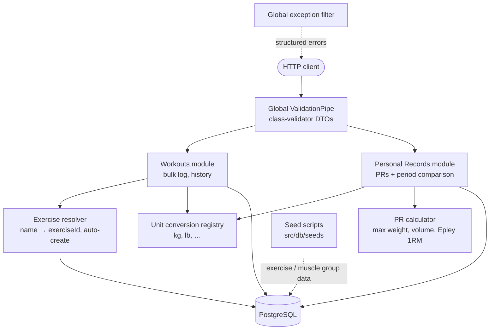
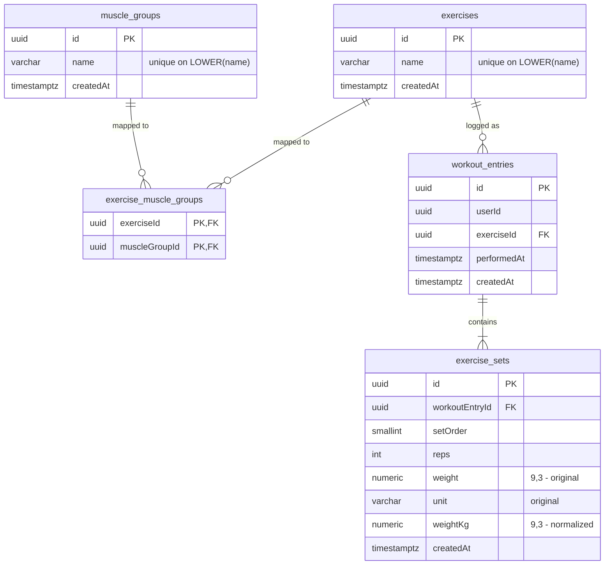

# Everfit — Workout Logging API

A REST API for coaches to log client workouts and track personal records (PRs) over time.

Built with **NestJS 12** + **PostgreSQL 16** + **TypeORM 0.3**, packaged with **Docker Compose**.

- [Architecture Overview](#architecture-overview)
- [Setup](#setup)
- [API Documentation](#api-documentation)
- [Database Schema](#database-schema)
- [Design Decisions & Trade-offs](#design-decisions--trade-offs)
- [What Would Change at Scale](#what-would-change-at-scale)
- AI workflow: see [AI_WORKFLOW.md](AI_WORKFLOW.md)

<!-- TODO: add your time estimate (made before starting) and actual time spent -->

## Architecture Overview



**Layers:** Controller → Service → Repository / DataSource → Entity. Controllers only handle HTTP concerns, services hold business logic, and pure logic (unit conversion, PR formulas, cursor encoding) lives in plain utility functions that are unit-tested without a database. Only logic with dependencies, like the exercise resolver, is an injectable provider.

**Cross-cutting:**
- **Validation** — a global `ValidationPipe` (`whitelist`, `forbidNonWhitelisted`, `transform`) rejects malformed input before it reaches a service.
- **Errors** — a global exception filter returns one error shape for every failure (see [Errors](#errors)).
- **Logging** — Winston via `nest-winston`, JSON output in production, one log line per request with method, path, status and duration.
- **Configuration** — `@nestjs/config` with typed, namespaced config (`src/config/`); every value comes from environment variables.

**Why NestJS:** dependency injection makes database-backed pieces (repositories, the exercise resolver) easy to mock in tests, and its module system maps cleanly onto the feature boundaries.

## Setup

### Option 1: Docker Compose (recommended)

```bash
docker compose up --build
```

The API is available at `http://localhost:3000` when running locally. Compose sets `NODE_ENV=local`, so the image runs `scripts/local-entrypoint.sh`: it waits for PostgreSQL, applies pending migrations (`npm run migration:run`), runs the seeders in `src/db/seeds/` (`npm run seed:run`), then starts the app in watch mode (`npm run start:dev`).

For hot reload, add `--watch` (Compose 2.22+): every change under `src/` is copied into the container and Nest restarts the app, and a change to `package.json` or `package-lock.json` rebuilds the image. Without `--watch` the container keeps the code it was built with; changes outside `src/` (e.g. `scripts/`, `tsconfig*.json`) always need `docker compose up --build`.

Migrations and seeds run only when the container starts. After adding one, run it in the running container: `docker compose exec everfit-backend npm run migration:run` (or `seed:run`). With `--watch` the new file is already there; without it, run `docker compose up --build` instead.

### Option 2: Manual setup

**Prerequisites:** Node.js 22+, PostgreSQL 16+

```bash
npm install
createdb everfit
cp .env.example .env         
npm run migration:run
npm run seed:run
npm run start:dev
```

### Environment variables

| Variable | Default | Description |
| --- | --- | --- |
| `PORT` | `3000` | HTTP port |
| `NODE_ENV` | `local` | Environment name (`local`, `dev`, `test`, `production`), included in every log line |
| `DB_HOST` / `DB_PORT` | `localhost` / `5432` | PostgreSQL connection |
| `DB_USERNAME` / `DB_PASSWORD` / `DB_NAME` | `everfit` / `everfit_password` / `everfit` | PostgreSQL credentials |
| `DB_LOGGING` | `false` | `true` prints every SQL query TypeORM runs (to the console, not through Winston) |
| `LOG_LEVEL` | `info` | Winston log level (`error`, `warn`, `info`, `debug`, `verbose`) |

Outside local Docker, run `npm run migration:run` as a deploy step before starting the app: the app never runs migrations itself, so replicas never race on schema changes.

### Running tests

```bash
npm test                    # unit tests, no database needed
npm run test:integration    # integration tests against the running app
```

Integration tests are black-box: they send HTTP requests to the app that is already running, so start it first (`docker compose up --build --watch`). Requests go to `http://localhost:${PORT}` (override with `INTEGRATION_TEST_BASE_URL`), and the tests open their own connection to the database in `.env` to seed and check data.

Tests and the app share that database. **The tests empty every entity table** before each test and when they finish (the migration history is kept); run `npm run seed:run` afterwards to restore the seed data. The schema is whatever migrations the app container applied on start, so after adding a migration run `docker compose restart everfit-backend` before testing. When a test gets a 500, the stack trace is in `docker compose logs everfit-backend`.

## API Documentation

No feature endpoints yet.

### Errors

Every error response has the same shape, produced by a global exception filter:

```json
{
  "statusCode": 400,
  "error": "Bad Request",
  "message": ["sets.0.reps must be a positive number"],
  "timestamp": "2026-01-15T10:00:00.000Z"
}
```

- `message` is **always an array**, even when there is a single message.
- Unknown request properties are rejected (`property foo should not exist`).
- 5xx responses never expose internals: the body is `["Internal server error"]` and the stack is logged server-side.

| Status | When |
| --- | --- |
| `200` | Successful retrieval (GET) or update (PATCH) |
| `201` | Successful creation (POST) |
| `400` | Validation error, malformed JSON, malformed cursor |
| `404` | Resource or route not found |
| `409` | Conflicting state |
| `500` | Unexpected server error |

## Database Schema



**`workout_entries`** — one row per exercise performed by a user at a point in time.
- `exerciseId` is a foreign key with `ON DELETE RESTRICT`: an exercise with history can't be deleted.
- Clients send `exerciseName`; the service resolves it to `exerciseId` (see [Exercise resolution](#exercise-resolution-and-concurrent-writes)).

**`exercise_sets`** — the individual sets of an entry.
- `ON DELETE CASCADE` from `workout_entries`; sets never exist without their entry.
- Stores the original `weight`/`unit` and the normalized `weightKg`.
- CHECK constraints back up DTO validation: `reps > 0`, `weight >= 0`, `weightKg >= 0`, `setOrder >= 1`.

**`exercises`, `muscle_groups`, `exercise_muscle_groups`** — the exercise catalog.
- Names are unique case-insensitively (unique expression index on `LOWER(name)`), so "Bench Press" and "bench press" are one exercise.
- Many-to-many: Bench Press → chest, triceps, shoulders. The join table uses a composite primary key.

### Why PostgreSQL over MongoDB

1. **Aggregations** — PRs are `ORDER BY … LIMIT 1` over a join, computed in SQL with exact `numeric` arithmetic.
2. **Relational data** — entries → sets and exercises ↔ muscle groups are naturally relational, with foreign keys and CHECK constraints enforcing integrity.
3. **Transactions** — bulk logging is atomic across many rows and tables.
4. **Indexing** — composite B-tree indexes match the access patterns exactly, and expression indexes give case-insensitive uniqueness.
